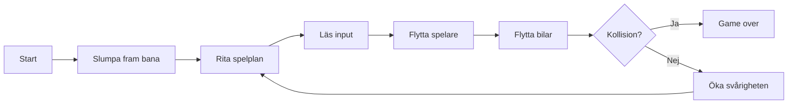

## Vår idé

Våran idé är att göra en textbaserad version av spelet crossy road som körs i terminalen. Spelaren ska försöka ta sig så långt som möjligt i en bana bestående av säkra områden och bilar, blir man påkörd är spelet över.

Problemet vi vill lösa är hur man bygger ett spel där bilarna rör sig oberoende av spelaren och hur programmet upptäcker krockar mellan dem. Vi vill också lösa hur en bana kan genereras slumpmässigt men ändå alltid gå att klara, med ökande svårighetsgrad.

Spelet är intressant för andra eftersom det fungerar som kort och enkel underhållning, till exempel mellan föreläsningar eller på bussen, som dessutom inte kräver någon inloggning. Problemet vi vill lösa är framför allt tekniskt och många av problemen är vanliga i andra spel, vilket gör dem användbara även utanför detta projekt.

## Systemets delar

Spelet nedbrutet i mindre delar:

- spelplan: alla rader, och vad som finns på dem
- hinder: bilar som rör på sig som spelaren inte får röra
- inmatning: känner av vilken input spelaren ger
- kollisionskontroll: kontrollerar så inte spelaren står på samma plats som en bil
- randomfunktion: funktion som på något sätt genererar en slumpmässig bana
- svårighetsändring: funktion som på något sätt ökar svårighet ju längre spelaren kommer

Ett mermaid-diagram över hur spelet kan fungera:

## Representation

| Datatyp | Sak | Exempel | Förklaring |
|---|---|---|---|
| **Tal** | Poäng | `poäng = 12` | Antal rader spelaren tagit sig framåt ger poäng |                                                                             
| **Tal** | Svårighetsgrad | `bil_chans = 0.2` | Sannolikheten att en ruta på en väg får en bil, ökar med poängen, t.ex. 20 procent chans för bil |
| **Booleans** | Game over | `game_over = False` | Blir `True` vid krock, spelet körs så länge den är `False` |
| **Strängar** | Inmatning | `tangent = "w"` | Tangenten spelaren trycker, `input()` ger en sträng, "w" för framåt |
| **Strängar** | Bil och tom ruta | `"B"` och `"."` | En bil är strängen `"B"` på en plats i en rad, en tom ruta är `"."` |
| **Listor** | Spelplan och rutor | `bana = [rad1, rad2, ...]` och `[".", "B", "B", "."]` | Raderna och rutorna ligger i en bestämd ordning, och nya slumpade rader kan läggas till när spelaren går framåt |
| **Dictionaries** | Rader | `{"typ": "väg", "riktning": 1, "rutor": [...]}` | En rad har flera egenskaper som får tydliga namn, gräs eller väg, riktning av bil, vad som finns i varje ruta etc. |
| **Tupler** | Spelarens position | `spelare = (5, 3)` | En tupel som räknar ut spelarens position, som inte kan ändras|

## Komplexitet och förenkling

En enkel version av spelet har stillastående bilar, konstant svårighetsgrad och en bana som upprepas i ett fast mönster. Därefter kan komplexitet läggas till steg för steg: bilar som rör sig, en slumpmässigt genererad bana, en poängräknare och en svårighetsgrad som ökar ju längre spelaren kommer. Om tid finns kan vi lägga till bilar med olika hastighet och valbara svårighetsnivåer.

## Personliga utvecklingsmål

Genom att bygga en applikation från grunden, från idé till färdig produkt, så tar vi hänsyn till båda våra utvecklingsmål. Vi får arbeta med hela processen: från planering och problemnedbrytning till implementation, och vi får särskilt öva på att använda slumpfunktioner för att generera en bana som ändå alltid går att klara. Eftersom vi arbetar i par fördelar vi uppgifterna så att var och en får ansvar för de delar som hör till sina egna mål. Samtidigt förklarar vi vår kod för varandra, så att båda lär sig av hela projektet och inte bara av sin egen del.